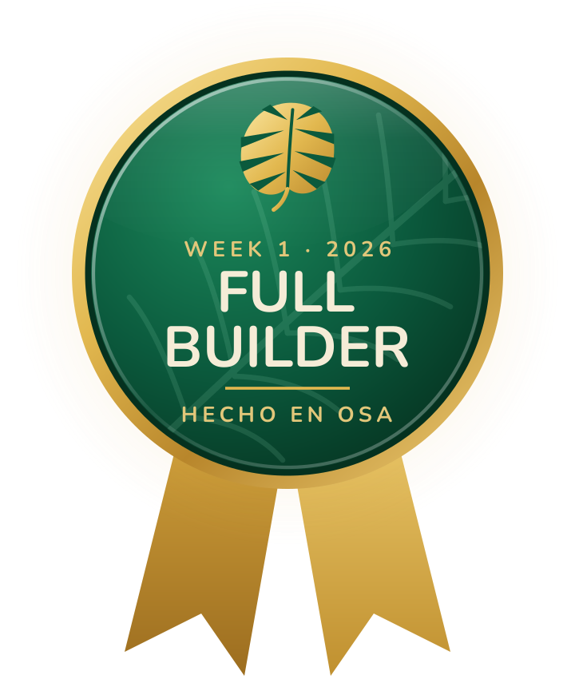
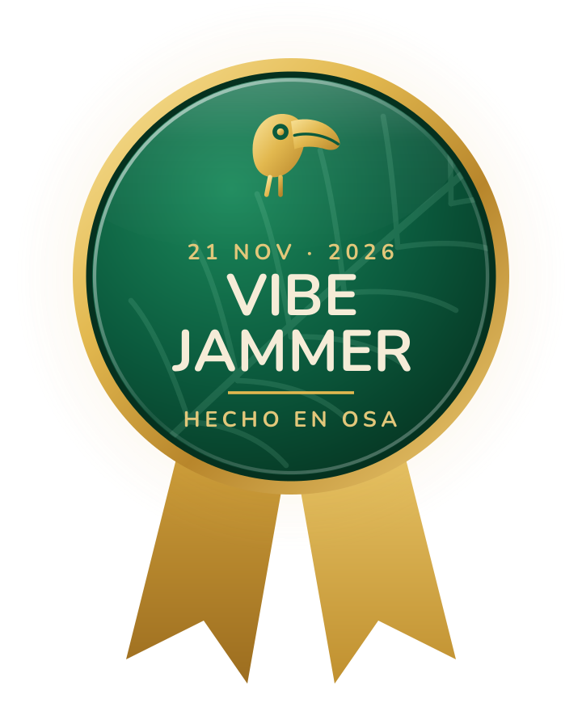
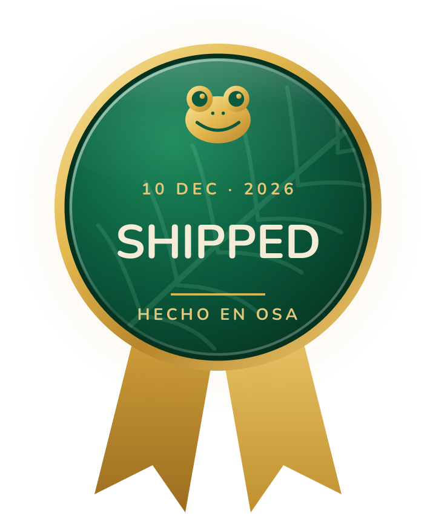
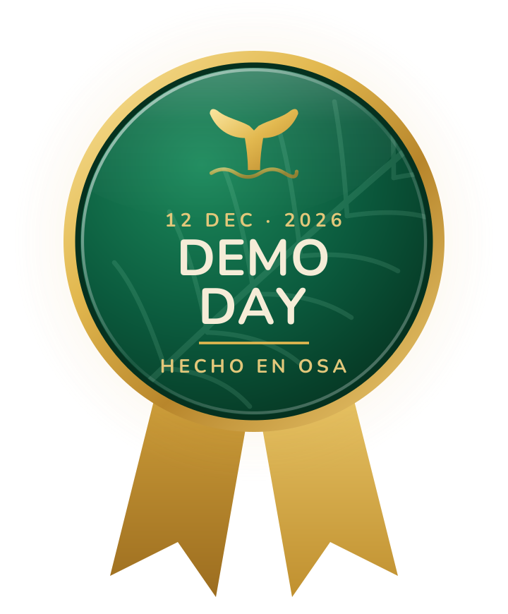
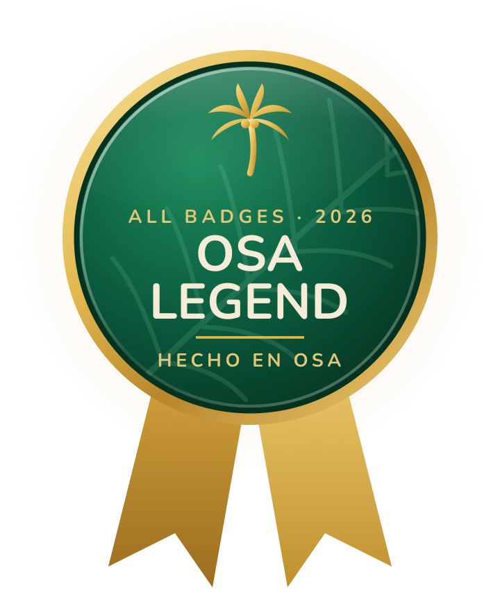

[← Back to Zero to Hero](README.md)

# 🏅 Hecho en Osa badges

Badges celebrate the big moments of the hackathon. Collect them all and you become an **Osa Legend** 🌴

| | Badge | How to earn it | Who |
|---|---|---|---|
|  | **Full Builder** · Week 1 | Finish all 15 steps of the [Week 1 assignment](weeks/week-1/assignment.md): tools, first commit, live website, your idea and your first update | 🌱 Zero to Hero |
|  | **Vibe Jammer** · Sat 21 Nov | Come to the Vibe Jam and build the first version of your project | Everyone |
|  | **Shipped** · Thu 10 Dec, 8 pm | Your project and README are on GitHub by code freeze | Everyone |
|  | **Demo Day** · Sat 12 Dec | Present your project on Demo Day | Everyone |
|  | **Osa Legend** | Earn every badge you can (Pro builders: the last three) | Everyone |

Physical builds count too: for **Shipped**, a README with photos of your build is your "project on GitHub".

## How you get a badge

1. You finish the milestone.
2. Your mentor or Anastasia posts your badge as a reply on your Wall issue in [hello-osa](https://github.com/hechoenosa/hello-osa/issues). GitHub emails you when it's posted.
3. You get a shout-out in your Mentor Room on WhatsApp.
4. Your handle goes on the Badge Wall below.

**Show it off:** make a repo with exactly your handle as its name (for example `your-handle/your-handle`) and paste this in its README. It shows at the top of your GitHub profile.

```

```

## 🧱 Badge Wall

| Builder | Badges |
|---|---|
| [@middleloaf](https://github.com/middleloaf) | 🏅 Full Builder |
| [@osa-developer](https://github.com/osa-developer) | 🏅 Full Builder |

*Mentors: add a row when you award a badge.*

**¡Hecho en Osa!** 🌴
