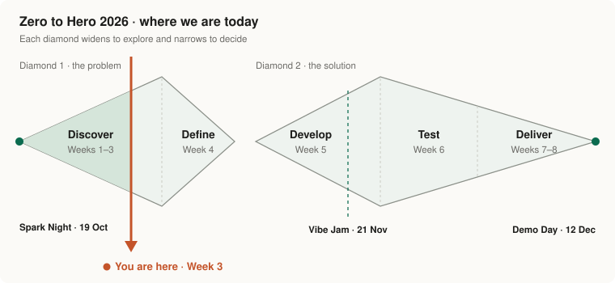

[← Week 2](../week-2/) · **Week 3 · Finalize your idea** · [Week 4 →](../week-4/)

# Week 3 · Finalize your idea

> [!CAUTION]
> **⏰ Due: Sunday 8 November, 8 pm**

> [!IMPORTANT]
> **🤝 Meet your mentor this week.** Set it up together in your Mentor Room. Pick one:
> - **🛠️ Build Hour:** Sat 7 Nov, 10–11 am, Centro de Libertad
> - **📍 A public place** you both choose
> - **💻 Online**, with a parent in the room
>
> Build Hour is **only for builders who planned to meet their mentor there**. No meeting planned? Please don't come. There is no open session.

Meet your mentor, find the real problem, talk to 2 real people, and decide the one thing your build has to do. Pen and paper all week, then one form on GitHub.

👉 **[Open the Week 3 assignment](assignment.md)**

---

[← Week 2](../week-2/) · **Week 3 · Finalize your idea** · [Week 4 →](../week-4/)
