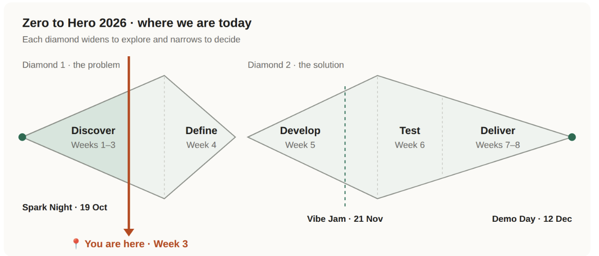

[← Week 3 overview](README.md) · [Rules](https://github.com/hechoenosa/zerotohero2026/blob/main/RULES.md) · [Stuck?](https://github.com/hechoenosa/zerotohero2026/blob/main/STUCK.md) · **Week 3 · Assignment** · [Week 4 →](../week-4/)

# Week 3 · Finalize your idea

**Due: Sunday 8 November, 8 pm** · Build Hour Sat 7 Nov, 10–11 am, Centro de Libertad

We're still in Discover, about 3/4 of the way through. This week you meet your mentor, find the real problem behind your idea, talk to real people, and decide the one thing your build has to do. No coding. Define comes in Week 4.

> ✏️ **Pen and paper all week.** Use a notebook or one sheet of paper. Write down everything that comes to mind. Only the last step happens on GitHub.

## At a glance

| | 🌱 Zero to Hero | 🚀 Pro |
|---|---|---|
| **Videos** | Watch all | Watch if you like |
| **Meet your mentor** | Required | Required |
| **Guides 1 and 2, on paper** | Required | Optional, a good start for your PRD |
| **What you send** | 📝 Week 3 form | 📈 Pro weekly update |

## 🌱 STEP 1 · Watch the videos 🎬

1. Anastasia · How this week works *(link coming)*
2. Zamir · [You are your biggest competition](https://drive.google.com/file/d/1IlUGu__63MqHPfh8uIZGHVAvbFVzXi8N/view)
3. Anastasia · First principles *(link coming)*
4. 🎬 [What you set up in Week 1, and why](https://hechoenosa.github.io/zerotohero2026/weeks/week-3/videos/what-you-set-up-in-week-1.mp4) (2 min): VS Code, Git, GitHub and your developer environment

## 🌱 STEP 2 · Meet your mentor 🤝

Your mentor's name is in your Mentor Room. Meet them at a Build Hour or another public place, or set up a call with a parent in the room. Set it up together in your Mentor Room first.

Tell them your idea, and ask one question you're stuck on.

## 🌱 STEP 3 · Find a real problem 🎯

Open 📄 [Guide 1 · Find a real problem](guide-1-find-a-real-problem.md) and work through it on paper:

1. **The problem:** "The problem is ___."
2. **The 5 Whys:** Ask "Why?" until you reach the REAL problem
3. **Persona:** One made-up person with your problem. Name, age, one thing they'd say.

## 🌱 STEP 4 · Interview 2 people 🎙️

This is your do-it-scared step. Use parts 4 and 5 of Guide 1.

- 2 people, 10+ minutes each, people like your persona
- Ask about **their** life. Never ask "Would you use my app?"
- Write down who, their exact words, and what surprised you

**Safety:** Always with an adult nearby · first names only · ask before recording

## 🌱 STEP 5 · Decide the one thing 1️⃣

Open 📄 [Guide 2 · Decide what to build](guide-2-decide-what-to-build.md).

Did the interviews change your problem or persona? Update them. Then answer: **If your build could only do one thing, what would it be?** If your sentence has "and", pick one.

## 🌱 STEP 6 · Make your Hackathon promise 🤞

"By Demo Day, 12 Dec, I promise to ___."

Pick something you control. For example: Finish every week's assignment, or block 2 hours every Saturday for my project.

## 🌱 STEP 7 · Type it in on GitHub 📝 (required)

1. Open the **[📝 Week 3 form](https://github.com/hechoenosa/zerotohero2026/issues/new?template=week-3.yml)**
2. Title: Write your handle after `Week 3: `
3. Every box matches a step on your paper, and the sentences are already started. Just fill in the blanks.
4. Click **Create** 🎉

## ✅ Done when

- ☐ Watched the videos
- ☐ Met your mentor
- ☐ Problem, 5 Whys and persona on paper
- ☐ 2 interviews, with real quotes
- ☐ The one thing
- ☐ Hackathon promise
- ☐ 📝 Week 3 form sent

**Mentors check on Monday:** Every builder has a Week 3 issue with a real quote, the one thing, a promise, and "Yes" to meeting their mentor.

## 🚀 Pro

**Every Sunday by 8 pm,** send a **[📈 Pro weekly update](https://github.com/hechoenosa/pro2026/issues/new?template=pro-update.yml)**. It's three questions and takes about 3 minutes.

- ☐ **Required:** Meet your mentor
- ☐ **Required:** Send your weekly update
- ☐ Optional: Watch the videos
- ☐ Optional: Do Guides 1 and 2. It's a great start for your PRD.

## 🆘 Stuck?

Check [STUCK.md](https://github.com/hechoenosa/zerotohero2026/blob/main/STUCK.md), then ask your mentor in your Mentor Room.
