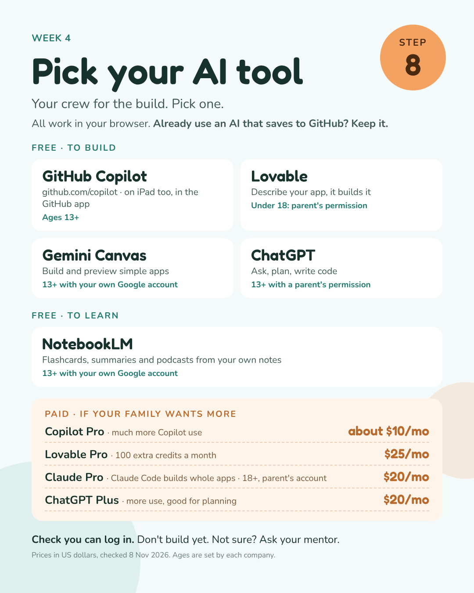

[← Week 4](README.md) · **AI tool options**

# Pick your AI tool 🤖

## Not sure? Start here

| | |
|---|---|
| 💻 **Builder on a laptop or desktop** | GitHub Copilot Free |
| 📱 **Builder on a phone or iPad** | Lovable Free |
| 🏠 **Family already pays for an AI** | Use it, if it can save to GitHub. Not sure? Ask your mentor |

## Set up GitHub Copilot Free

1. Sign in at **github.com** with your builder's account.
2. Go to **[github.com/settings/copilot](https://github.com/settings/copilot)** and click **Start using Copilot Free**.
3. **Laptop with VS Code:** click the Copilot icon at the top, **Sign in with GitHub**, open the chat, switch the mode to **Agent**.
4. **Old laptop, Chromebook, iPad with a keyboard:** open your repo on github.com → green **Code** button → **Codespaces** → **Create codespace on main**. Open the Copilot chat, switch to **Agent**. When you're done: **Code** → **…** → **Stop codespace** to save free hours.
5. **Phone or iPad:** chat at **[github.com/copilot](https://github.com/copilot)**, or in the **GitHub** app.

## Set up Lovable Free

1. **Phone or iPad:** install **"Lovable: Build Apps With AI"** by **Lovable Labs Incorporated**. A look-alike app from another company has a similar name. **Computer:** go to **[lovable.dev](https://lovable.dev)**.
2. **Sign up** with an email your family checks. Stay on the free plan, skip upgrade screens.
3. **Connect GitHub once, in a browser:** open the project on lovable.dev → **Project settings** → **Git** → **GitHub** → **Connect GitHub** → sign in → **Authorize** → install on your builder's **personal account** → back in Lovable, click **Connect**.

**Open the others:** [Gemini](https://gemini.google.com) · [ChatGPT](https://chatgpt.com) · [NotebookLM](https://notebooklm.google.com)

Pick one. Check that you can log in. **Don't build anything yet.**

Prices in US dollars, checked 8 Nov 2026: [Copilot](https://github.com/features/copilot/plans) · [Lovable](https://lovable.dev/pricing) · [ChatGPT](https://chatgpt.com/pricing) · [Claude](https://support.anthropic.com/en/articles/8325610-how-much-does-claude-pro-cost). Ages are set by each company and can be higher in some countries.
