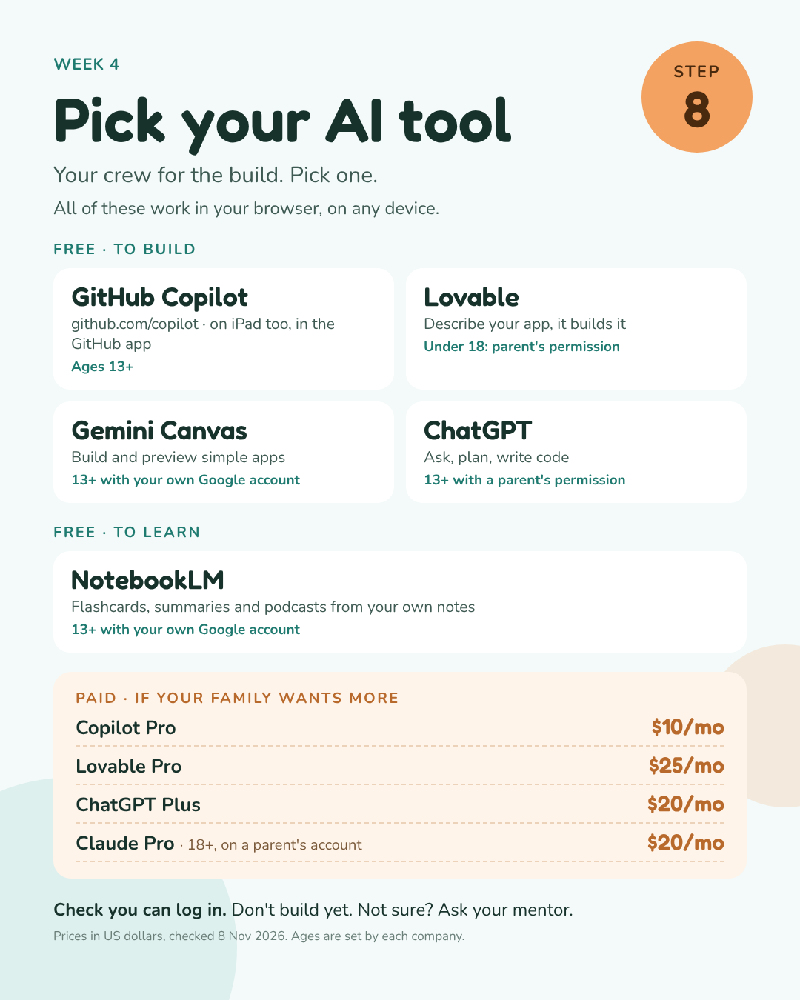

[← Week 4 assignment](assignment.md) · **AI tool options**

# Pick your AI tool 🤖

**Open them here:** [GitHub Copilot](https://github.com/copilot) · [Lovable](https://lovable.dev) · [Gemini](https://gemini.google.com) · [ChatGPT](https://chatgpt.com) · [NotebookLM](https://notebooklm.google.com)

**Copilot on iPad:** use [github.com/copilot](https://github.com/copilot) in Safari, or the GitHub app.

Pick one. Check that you can log in. **Don't build anything yet.** Not sure? Ask your mentor in your Mentor Room.

Prices in US dollars, checked 8 Nov 2026 on each company's pricing page: [Copilot](https://github.com/features/copilot/plans) · [Lovable](https://lovable.dev/pricing) · [ChatGPT](https://chatgpt.com/pricing) · [Claude](https://support.anthropic.com/en/articles/8325610-how-much-does-claude-pro-cost). Ages are set by each company and can be higher in some countries.
