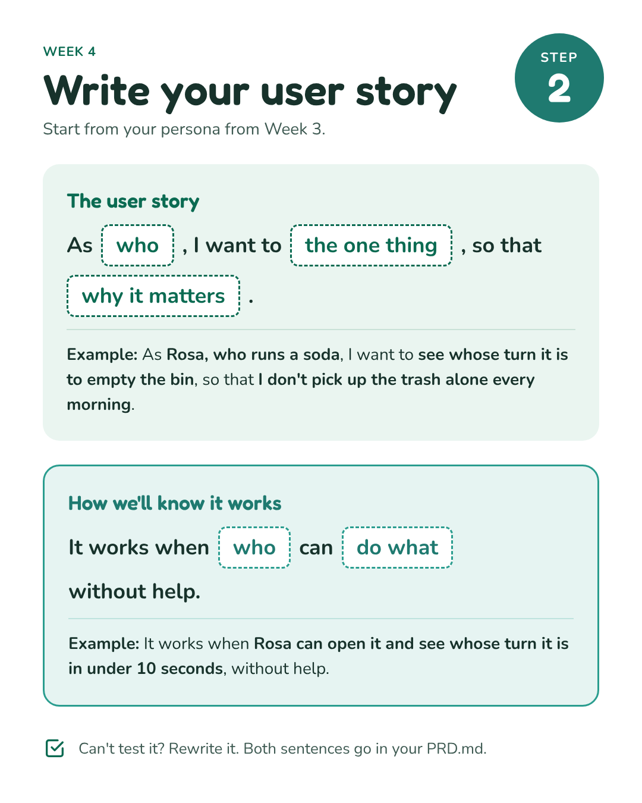
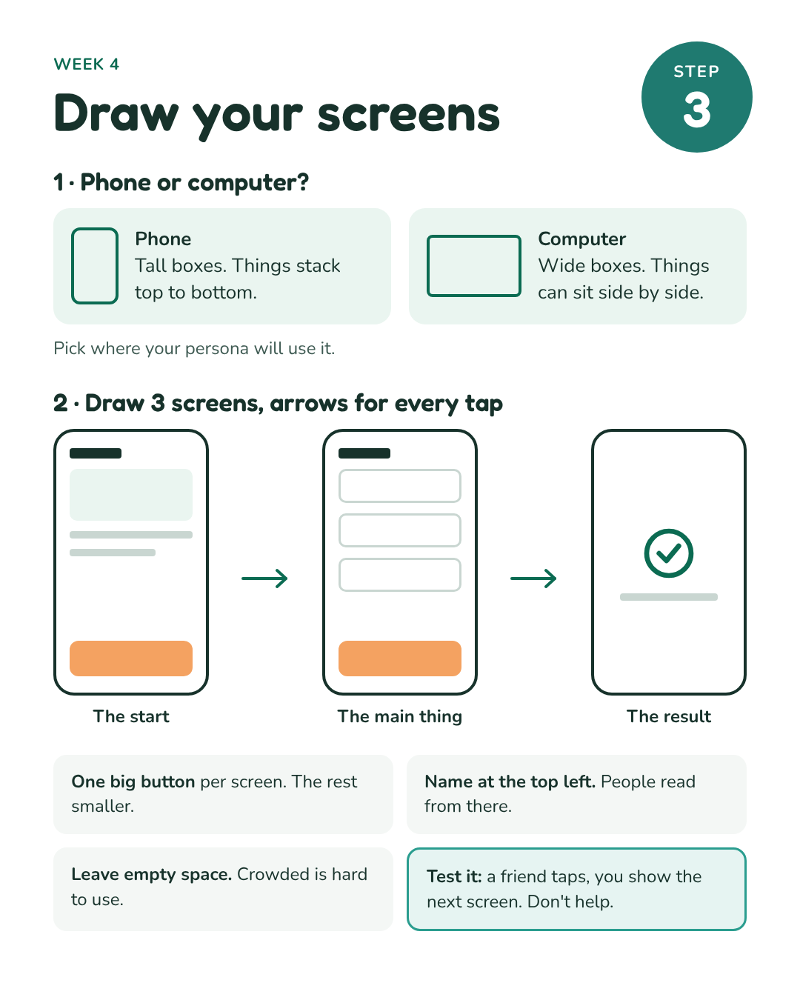
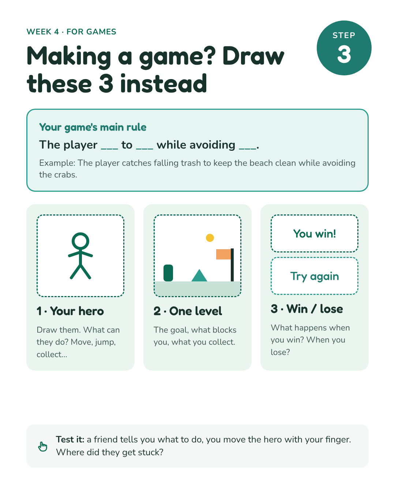
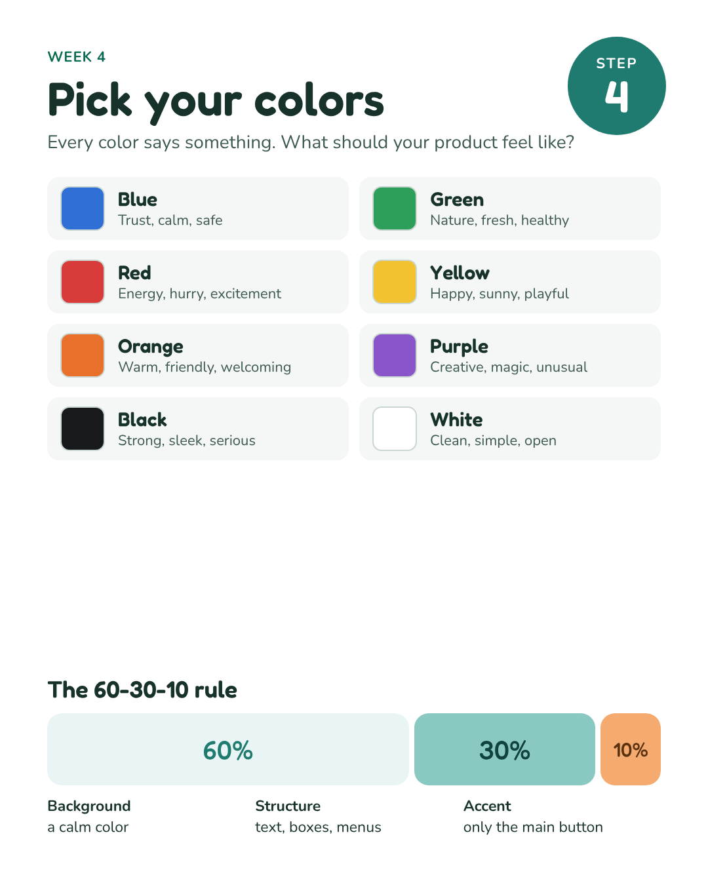
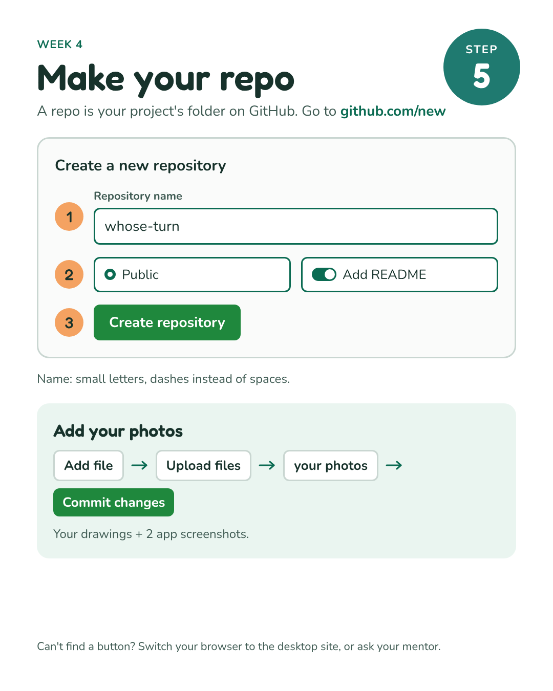
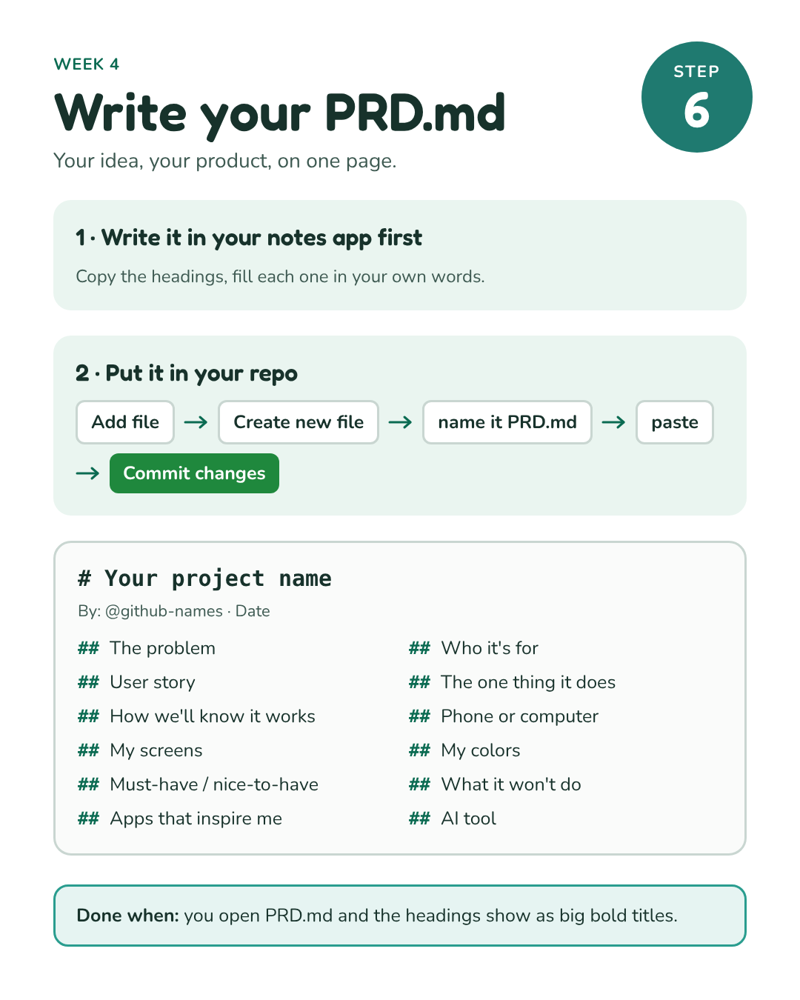
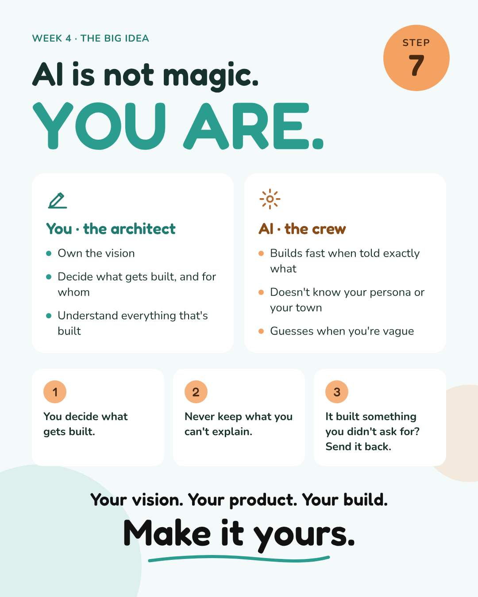
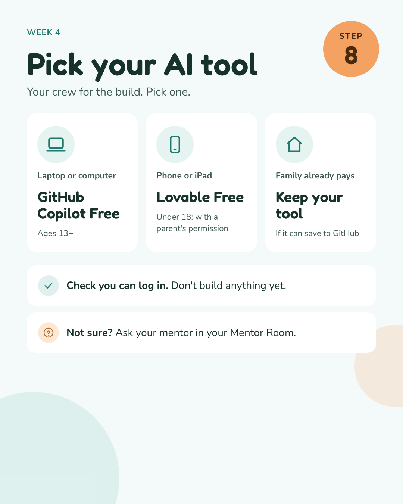
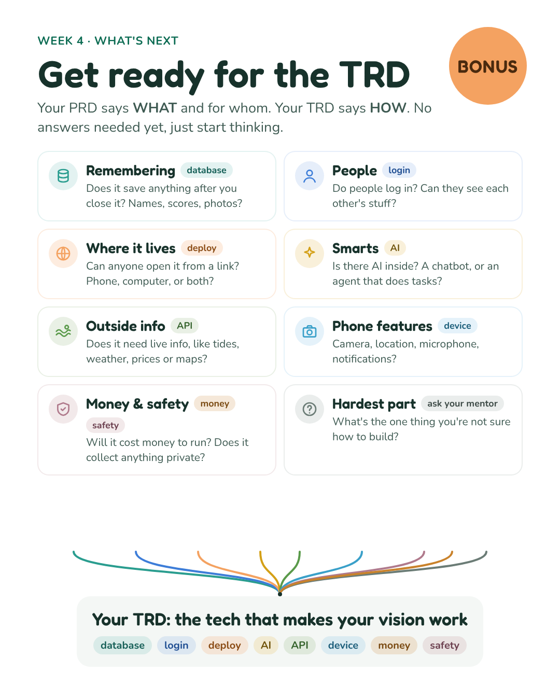
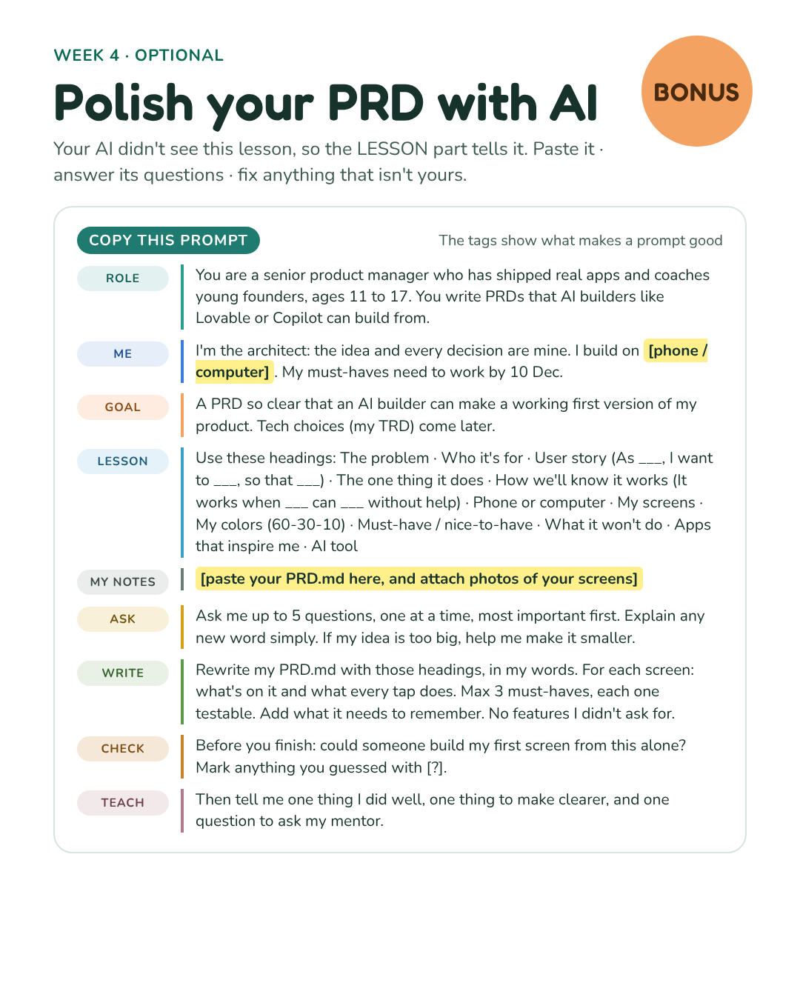

[← Week 4 overview](README.md) · [Rules](https://github.com/hechoenosa/zerotohero2026/blob/main/RULES.md) · [Stuck?](https://github.com/hechoenosa/zerotohero2026/blob/main/STUCK.md) · **Week 4 · Assignment** · [Week 5 →](../week-5/)

# Week 4 · Design your product → PRD.md

### 🔴 Due: Sunday 15 November, 8 pm

> **🤝 Show your mentor your screens this week.** Set it up together in your Mentor Room.

**At the end of this week you have:** a project name, a repo in your own GitHub, and **PRD.md** in it with photos of your screens.

| | 🌱 Zero to Hero | 🚀 Pro |
|---|---|---|
| **Videos** | Watch all | Watch if you like |
| **Screens + PRD.md** | Required | Optional, if your PRD isn't done |
| **What you send** | [📝 Week 4 form](https://hechoenosa.github.io/zerotohero2026/forms/week-4.html) | [📈 Pro weekly update](https://hechoenosa.github.io/zerotohero2026/forms/pro-update.html) |

## 🌱 STEP 1 · Watch 🎬

1. 🎬 What is a PRD? (Anastasia) · *coming soon*
2. 🎬 Draw it like a Designer · *coming soon*
3. 🎬 Write your user story · *coming soon*
4. 🎬 You are the architect. AI is not magic. YOU ARE. · *coming soon*

## 🌱 STEP 2 · Write your user story 🧑



Give your project a name too, your brand. Short, easy to say, easy to spell. It becomes your repo name.

## 🌱 STEP 3 · Draw your screens ✏️



**Making a game?** Draw these 3 instead:



Take screenshots of 2 apps or websites you like, too. What's good about them? What's missing for your persona?

## 🌱 STEP 4 · Pick your colors 🎨



## 🌱 STEP 5 · Make your repo 📁



👉 **[github.com/new](https://github.com/new)**

## 🌱 STEP 6 · Write your PRD.md 📝



👉 **[Copy the PRD headings](prd-template.md)**

## 🌱 STEP 7 · You are the architect 🏛️



## 🌱 STEP 8 · Pick your AI tool 🤖



👉 **[AI tool options](ai-tools.md)** · Check you can log in. Don't build yet.

## 🌱 STEP 9 · Send it ✅

1. Open the **[📝 Week 4 form](https://hechoenosa.github.io/zerotohero2026/forms/week-4.html)**
2. Title: write your handle after `Week 4: `
3. Paste your repo link, pick your AI tool and your device
4. Click **Create** 🎉
5. Share your repo link in your Mentor Room

## ✅ Done when

- ☐ Watched the videos
- ☐ Showed your mentor your screens
- ☐ User story and "how we'll know it works"
- ☐ 3 screens (or your game), drawn, colored and tested
- ☐ Repo with your photos
- ☐ PRD.md
- ☐ AI tool picked, you can log in
- ☐ 📝 Week 4 form sent

## ⭐ Bonus





Copy this prompt into your AI tool. Fill in the highlighted parts:

```
You are a senior product manager who has shipped real apps and coaches young founders, ages 11 to 17. You write PRDs that AI builders like Lovable or Copilot can build from.
I'm the architect: the idea and every decision are mine. I build on [phone / computer]. My must-haves need to work by 10 Dec.
Goal: a PRD so clear that an AI builder can make a working first version of my product. Tech choices (my TRD) come later.
Use these headings: The problem · Who it's for · User story (As ___, I want to ___, so that ___) · The one thing it does · How we'll know it works (It works when ___ can ___ without help) · Phone or computer · My screens · My colors (60-30-10) · Must-have / nice-to-have · What it won't do · Apps that inspire me · AI tool

[paste your PRD.md here, and attach photos of your screens]

Ask me up to 5 questions, one at a time, most important first. Explain any new word simply. If my idea is too big, help me make it smaller.
Then rewrite my PRD.md with those headings, in my words. For each screen: what's on it and what every tap does. Max 3 must-haves, each one testable. Add what it needs to remember. No features I didn't ask for.
Before you finish: could someone build my first screen from this alone? Mark anything you guessed with [?].
Then tell me one thing I did well, one thing to make clearer, and one question to ask my mentor.
```

## 🔧 Physical builds

Your design is due this week. Start getting your materials.

## 🚀 Pro

**Every Sunday by 8 pm,** send a **[📈 Pro weekly update](https://hechoenosa.github.io/zerotohero2026/forms/pro-update.html)**. Three questions, about 3 minutes.

- ☐ **Required:** Meet your mentor
- ☐ **Required:** Send your weekly update
- ☐ Optional: Watch the videos
- ☐ Optional: Screens and PRD.md, if your PRD isn't done yet

**Mentors check on Monday:** every builder has a repo with photos of their screens and a PRD.md in their own words.

## 🆘 Stuck?

Check [STUCK.md](https://github.com/hechoenosa/zerotohero2026/blob/main/STUCK.md), then ask your mentor in your Mentor Room.
