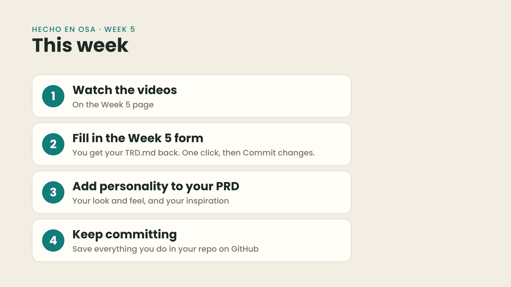
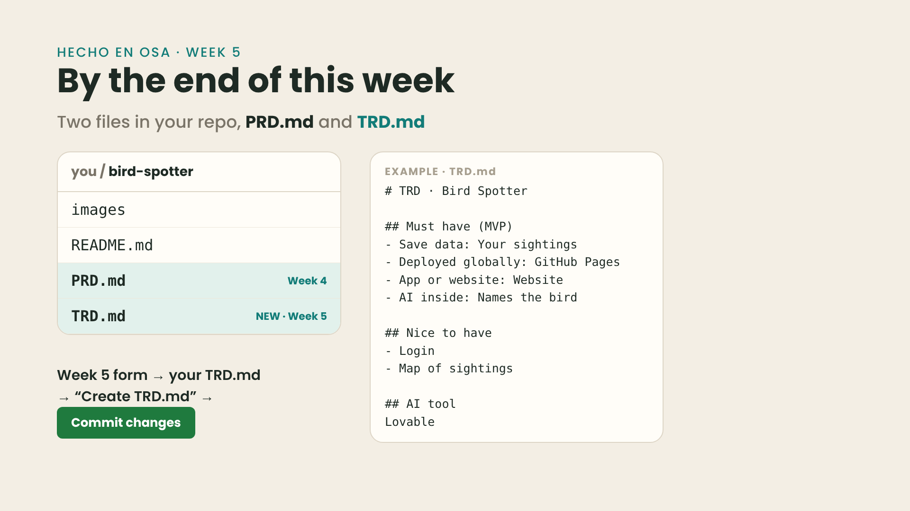
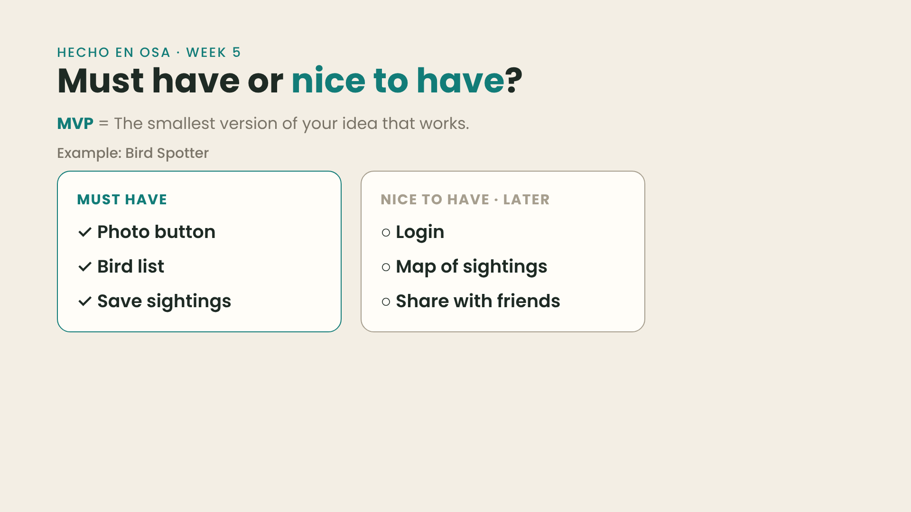
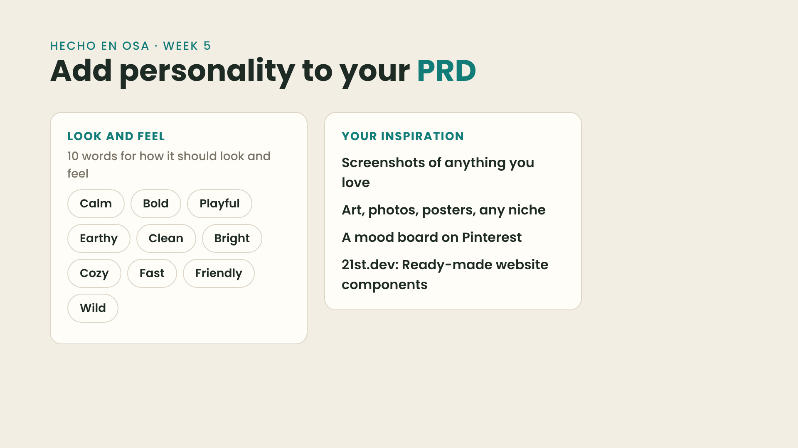
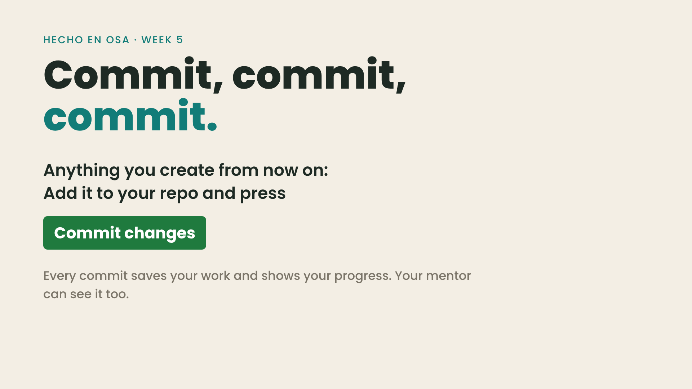
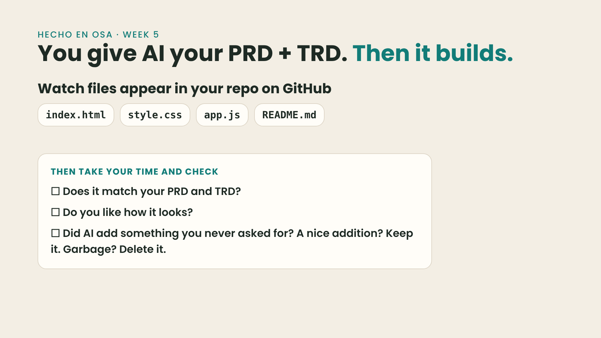
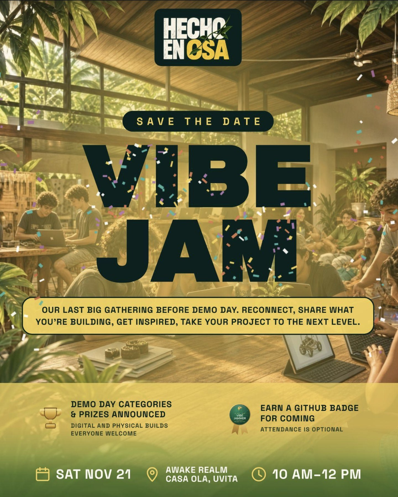

[← Week 4](../week-4/) · **Week 5 · Your TRD → TRD.md** · [Week 6 →](../week-6/)

# Week 5 · Your TRD → TRD.md

### 🔴 Due: Friday 20 November, 8 pm · So your TRD.md is ready for the Vibe Jam

**Quick links:** [🎬 All videos](https://hechoenosa.github.io/zerotohero2026/weeks/week-5/) · [📝 Week 5 form](https://hechoenosa.github.io/zerotohero2026/forms/week-5.html) · [📈 Pro weekly update](https://hechoenosa.github.io/zerotohero2026/forms/pro-update.html) · [🤖 Master prompt](#-master-prompt) · [🎉 Vibe Jam](#-vibe-jam) · [🆘 Stuck?](https://github.com/hechoenosa/zerotohero2026/blob/main/STUCK.md)



**At the end of this week you have:** Two files in your repo, **PRD.md** and **TRD.md**.

| | 🌱 Zero to Hero | 🚀 Pro |
|---|---|---|
| **Videos** | Watch all | Watch if you like |
| **TRD.md** | Required | Optional |
| **What you send** | [📝 Week 5 form](https://hechoenosa.github.io/zerotohero2026/forms/week-5.html) | [📈 Pro weekly update](https://hechoenosa.github.io/zerotohero2026/forms/pro-update.html) |

## 🌱 STEP 1 · Watch 🎬

▶️ **[All Week 5 videos on one page](https://hechoenosa.github.io/zerotohero2026/weeks/week-5/)**, or tap a title below.

1. 🎬 [What Week 5 is about](https://drive.google.com/file/d/1may9IsFqqqmQLBfiBSSoDCGFbozK-XKC/view) (5 min): Anastasia · where we are, your TRD, what happens at the Vibe Jam
2. 🎬 [Your TRD](https://drive.google.com/file/d/1h4r0641HxtEcc22lM9K40wgb7h9CvtCF/view) (7 min): System design, files, and the questions your TRD answers
3. 🎬 [AI is not magic. You are.](https://drive.google.com/file/d/1fVGSyG9hhH8vWEyshATMYWncd22StfIE/view) (8 min): How AI works, where it goes wrong, and how you stay the boss
4. 🎬 Suggested: [The centipede and the fox](https://drive.google.com/file/d/1Q7cwLjY9lXTjpdw6AsDVs_ymRi-3ScJJ/view) (3 min): A story from Zamir about clarity, your goal, and just starting

## 🌱 STEP 2 · Fill in the Week 5 form 📝



1. Make sure your repo is **public**
2. Open the **[📝 Week 5 form](https://hechoenosa.github.io/zerotohero2026/forms/week-5.html)**
3. Title: Write your handle after `Week 5: `
4. Paste your repo link and answer the questions
5. Click **Create** 🎉
6. A minute later you get a reply. Click **Create TRD.md in your repo**, check it, then press the green **Commit changes** button

**For each question, decide:** Must have for your MVP, nice to have, or not needed.



## 🌱 STEP 3 · Add personality to your PRD ✨



Add two new headings to your PRD.md:

- `## Look and feel`: 10 words for how your product should look and feel
- `## Inspiration`: Screenshots of anything you love (art, photos, posters, any niche), a [Pinterest](https://www.pinterest.com) mood board, and for websites, components from [21st.dev](https://21st.dev)

## 🌱 STEP 4 · Keep committing 💾



## 🤖 Master prompt

At the Vibe Jam you give your PRD and your TRD to your AI tool. Copy this prompt and fill in the highlighted parts:

```
You are my product team: A product manager, a staff engineer and a staff designer. I'm hiring you to build the first version (MVP) of my product.

I'm giving you:
- PRD.md: What I'm building and who it's for
- TRD.md: How it should work. Build only the parts marked "Must have".
- Look and feel: [Your 10 words]
- Inspiration: [Your screenshots and links]

Before you write any code:
1. Tell me in plain words what you'll build, and list the files you'll create.
2. Ask me up to 5 questions about anything unclear.

Then build in small steps. After each step, tell me how to run it and what to check. Use free tools only. Never put secret keys in the code. If you're not sure about something, say so.
```



## 🎉 Vibe Jam

**Saturday 21 November · 10 AM–12 PM · Awake Realm, Casa Ola, Uvita**

Our last big gathering before Demo Day. Demo Day categories and prizes announced, and a GitHub badge for coming. Optional, everyone welcome. Bring your PRD, your TRD and your inspiration.



## ✅ Done when

- ☐ Watched the videos
- ☐ 📝 Week 5 form sent
- ☐ TRD.md in your repo
- ☐ Look and feel and inspiration added to your PRD.md
- ☐ Everything committed

## 🔧 Physical builds

Zamir is sharing your requirements with you this week.

## 🚀 Pro

**Every Sunday by 8 pm,** send a **[📈 Pro weekly update](https://hechoenosa.github.io/zerotohero2026/forms/pro-update.html)**. Three questions, about 3 minutes.

- ☐ **Required:** Meet your mentor
- ☐ **Required:** Send your weekly update
- ☐ Optional: Watch the videos
- ☐ Optional: TRD.md

**Mentors check on Monday:** Every builder has PRD.md and TRD.md in their repo.

## 🆘 Stuck?

Check [STUCK.md](https://github.com/hechoenosa/zerotohero2026/blob/main/STUCK.md), then ask your mentor in your Mentor Room.

---

[← Week 4](../week-4/) · **Week 5 · Your TRD → TRD.md** · [Week 6 →](../week-6/)
